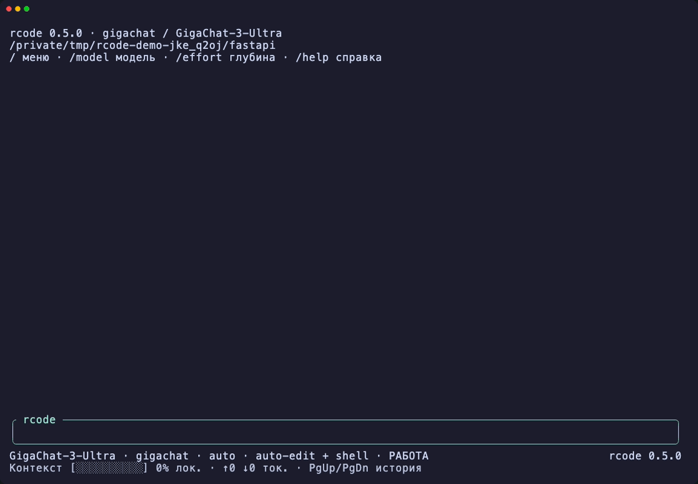

# rcode

**Терминальный агент для разработки с российскими LLM и свободным выбором провайдера.**

[](https://github.com/adw0rd/rcode/actions/workflows/ci.yml)
[](https://github.com/adw0rd/rcode/releases/latest)
[](LICENSE)

Выберите GigaChat, Yandex AI Studio, OpenRouter или свой OpenAI-совместимый API, подключите ключ и опишите задачу. rcode изучает проект, редактирует файлы, запускает команды и проверяет результат. Написан на Rust, интерфейс и справка — на русском.



*GigaChat-3-Ultra создаёт небольшое приложение на FastAPI и проверяет его тестами. Запись настоящего CLI; паузы ожидания сокращены.*

## Установка

На macOS и Linux с Homebrew:

```sh
brew install adw0rd/tap/rcode
```

Для обновления:

```sh
brew update
brew upgrade adw0rd/tap/rcode
```

После обновления перезапустите rcode. Настройки, ключи и сессии сохраняются отдельно от бинарника.

Скачайте архив для своей платформы со [страницы релизов](https://github.com/adw0rd/rcode/releases/latest), распакуйте и добавьте `rcode` в `PATH`.

| Платформа | Архитектура архива |
| --- | --- |
| macOS, Apple Silicon | `aarch64-apple-darwin` |
| macOS, Intel | `x86_64-apple-darwin` |
| Linux, glibc 2.35+ | `x86_64-unknown-linux-gnu` |
| Windows | `x86_64-pc-windows-msvc` |

Или установите из исходников с Rust **1.88+**:

```sh
cargo install --git https://github.com/adw0rd/rcode.git --tag v0.6.2 --locked
```

## Начать работу

Перейдите в папку проекта и запустите:

```sh
rcode
```

При первом запуске мастер предложит провайдера, ссылку для получения ключа и список моделей. Ключ вводится скрыто и сохраняется локально. После подключения просто напишите задачу:

```text
Создай приложение на FastAPI с GET /health и GET /greet?name=Мир.
Добавь тесты и проверь, что они проходят.
```

Для другой папки: `rcode -C /путь/к/проекту`. Для переключения модели используйте `/model`: последняя выбранная модель стоит первой, её можно принять нажатием Enter. `/provider` переключает провайдера и показывает доступные балансы в скобках.

## Провайдеры

| Провайдер | Подключение | Что понадобится |
| --- | --- | --- |
| [GigaChat](https://developers.sber.ru/studio/) | `rcode connect gigachat` | Authorization Key и выданный Scope, например `GIGACHAT_API_PERS` |
| [Yandex AI Studio](https://aistudio.yandex.ru/) | `rcode connect yandex` | Секретный API-ключ и Folder ID каталога Yandex Cloud |
| [OpenRouter](https://openrouter.ai/settings/keys) | `rcode connect openrouter` | API-ключ; модели выбираются из каталога провайдера |
| Свой API | `rcode connect custom` | OpenAI-совместимый endpoint и ключ |
| Локальная модель | `rcode connect local` | Запущенный вами сервер Ollama, llama.cpp, MLX или LM Studio на 127.0.0.1; ключ не обязателен |

Для GigaChat сертификат подключается автоматически, access token обновляется без участия пользователя. У Yandex идентификатор API-ключа и Folder ID — разные значения: нужен [ID каталога](https://yandex.cloud/ru/docs/resource-manager/operations/folder/get-id).

Нужны собственный API-ключ и баланс или квота провайдера. Подписка на веб-чат не заменяет доступ к API. Для работы агента выбирайте модель с вызовом инструментов; для скриншотов — с поддержкой изображений. Список доступных моделей: `rcode models --provider gigachat`.

## Локальная модель

rcode подключается к уже запущенному OpenAI-совместимому серверу на этом компьютере. Сервер и модель запускаете вы: rcode ничего не скачивает и не меняет настройки сервера.

```sh
rcode local discover        # 127.0.0.1:11434, :8080 и :1234
rcode local add qwen --base-url http://127.0.0.1:11434/v1 --model qwen3:8b --activate
rcode exec --profile qwen 'Объясни структуру проекта'
```

В диалоге: `/provider` → `local` → профиль или «Найти локальные серверы» → модель. Профилей может быть несколько, активный сохраняется.

- Адрес — только 127.0.0.1, localhost или ::1. Удалённые API подключайте через `custom`.
- Ключ необязателен. Если сервер его требует, передайте ключ не короче 8 символов: `--api-key-stdin` при добавлении или `rcode local key ИМЯ --stdin`. Ключ уходит только на адрес своего профиля; ключи облачных провайдеров из окружения не используются.
- Контекст задаёт сервер: `--context-tokens` (по умолчанию 32768) лишь сообщает rcode его размер. У llama.cpp и Ollama rcode читает фактический контекст, когда сервер его сообщает. Футер показывает оценку в токенах.
- В одном процессе rcode идёт одна генерация на сервер: субагенты ждут очереди. Отдельно запущенные rcode эту очередь не делят.
- Вызов инструментов зависит от модели и сервера; llama.cpp запускайте с `--jinja`. Изображения отправляются только при `--vision`.
- Для моделей с рассуждениями: поля reasoning и ведущий блок `<think>` скрываются. Модели, которые думают всегда (например, `*-Thinking`), добавляйте с `--thinking on`, если сервер поддерживает этот параметр; для Ollama он недоступен.

Подробнее — в [руководстве](docs/usage.md#локальная-модель).

## Возможности

- Чтение, поиск и правка файлов с показом diff; отмена файловых изменений через `/undo`.
- Команды shell, запуск проверок и ручные команды через `!`, например `!git status`.
- Выбор модели и поддерживаемого effort без выхода из диалога.
- Субагенты для исследования, выполнения задач и ревью.
- Скриншоты PNG/JPEG/TIFF: вставьте путь к файлу или используйте `/attach`.
- Сохранённые сессии, история ввода, автокомпакт и экспорт диалога в Markdown.
- Полноэкранный интерфейс с Markdown, закреплённым футером, прокруткой и копированием мышью.
- Баланс OpenRouter и остатки пакетов GigaChat в футере с обновлением раз в минуту.

## Основные команды

| Команда | Действие |
| --- | --- |
| `/model`, `/effort` | Выбрать модель и доступную глубину рассуждений |
| `/provider` | Выбрать провайдера и посмотреть доступные балансы |
| `/balance` | Обновить баланс провайдера и посмотреть лимиты ключа |
| `/connect` | Подключить провайдера |
| `/permissions` | Выбрать режим доступа |
| `/plan` | Перейти к планированию без изменений файлов |
| `/diff`, `/undo` | Посмотреть изменения или отменить файловые правки |
| `/resume ID` | Восстановить нужную сессию |
| `/attach "скрин.tiff" Что за ошибка?` | Отправить изображение с вопросом |
| `/export` | Сохранить доступную переписку в Markdown |
| `/agents` | Посмотреть задачи субагентов |
| `/help` | Все команды и сочетания клавиш |

Нажмите `/` для меню, Ctrl+P/N для истории ввода, Shift+Enter для новой строки. Если терминал не различает Shift+Enter, используйте Alt+Enter или Ctrl+J. Колесо мыши прокручивает ответы, выделение копирует текст. Esc или Ctrl+C прерывают текущую работу.

На вопрос «Какой сейчас баланс?» агент сам проверит остаток текущего провайдера и ответит по данным API. Результат явной проверки сохраняется в диалоге; фоновый индикатор остаётся локальным.

Сессии сохраняются между запусками:

```sh
rcode sessions
rcode --resume ID_СЕССИИ
```

`rcode --resume` без ID выбирает последнюю сохранённую сессию текущего проекта. При параллельной работе используйте конкретный ID.

## Разрешения и данные

По умолчанию rcode показывает diff и запрашивает подтверждение изменений и shell-команд. `/permissions auto-edit` разрешает файловые правки, `/permissions full-access` — также shell и внешние каталоги без подтверждений. Режим сохраняется для текущего проекта.

Shell работает с правами вашего пользователя. `/undo` отменяет правки файловых инструментов; изменения shell отменяются вручную. Известные секретные файлы и игнорируемые пути закрыты для файловых инструментов. Собственный ввод `!команда` выполняется сразу как явное действие пользователя.

Настройки, ключи и сессии лежат отдельно от бинарника и сохраняются после его обновления. На macOS это `~/Library/Application Support/rcode`. Ключи хранятся локально без шифрования; на Unix файлы создаются с правами `0600`. Контекст проекта и вложения передаются выбранному вами API при запросах к модели.

Подробнее: [руководство](docs/usage.md), [история изменений](CHANGELOG.md), [участие в разработке](CONTRIBUTING.md).

## Лицензия

[MIT](LICENSE).
