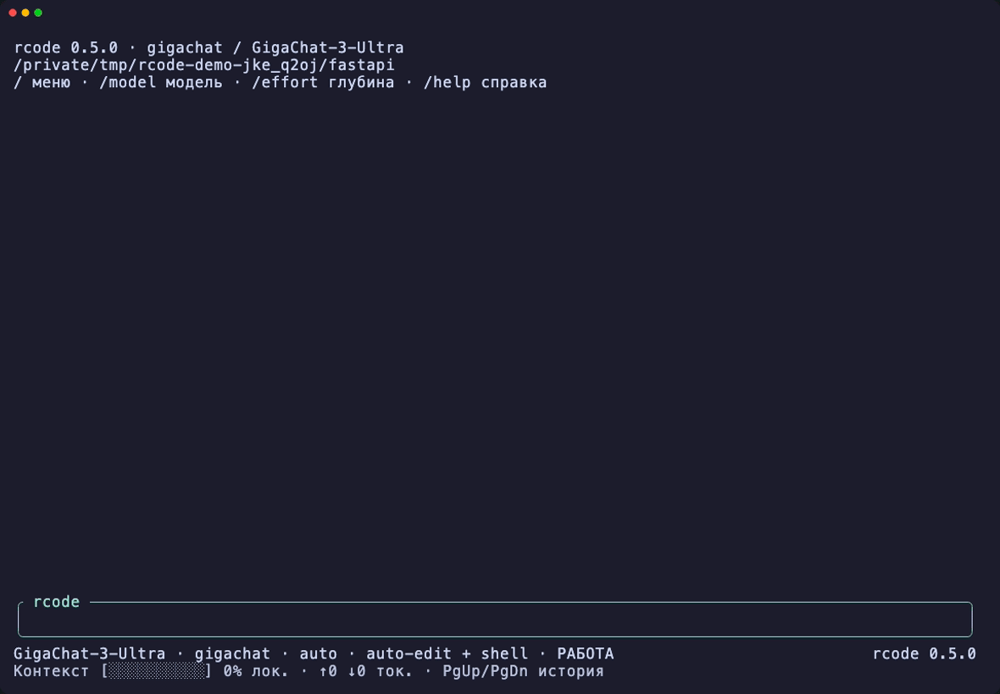

# rcode

**Терминальный агент для разработки с российскими LLM и свободным выбором провайдера.**

[](https://github.com/adw0rd/rcode/actions/workflows/ci.yml)
[](https://github.com/adw0rd/rcode/releases/latest)
[](LICENSE)

Выберите GigaChat, Yandex AI Studio, OpenRouter, локальную модель (Ollama, llama.cpp, MLX, LM Studio на вашем компьютере) или свой OpenAI-совместимый API, подключите ключ и опишите задачу. rcode изучает проект, редактирует файлы, запускает команды и проверяет результат. Написан на Rust, интерфейс и справка — на русском.



*GigaChat-3-Ultra создаёт небольшое приложение на FastAPI и проверяет его тестами. Запись настоящего CLI; паузы ожидания сокращены.*

## Установка

На macOS и Linux с Homebrew:

```sh
brew install adw0rd/tap/rcode
```

Для обновления:

```sh
brew update
brew upgrade adw0rd/tap/rcode
```

После обновления перезапустите rcode. Настройки, ключи и сессии сохраняются отдельно от бинарника.

Скачайте архив для своей платформы со [страницы релизов](https://github.com/adw0rd/rcode/releases/latest), распакуйте и добавьте `rcode` в `PATH`.

| Платформа | Архитектура архива |
| --- | --- |
| macOS, Apple Silicon | `aarch64-apple-darwin` |
| macOS, Intel | `x86_64-apple-darwin` |
| Linux, glibc 2.35+ | `x86_64-unknown-linux-gnu` |
| Windows | `x86_64-pc-windows-msvc` |

Или установите из исходников с Rust **1.88+**:

```sh
cargo install --git https://github.com/adw0rd/rcode.git --locked
```

## Начать работу

Перейдите в папку проекта и запустите:

```sh
rcode
```

При первом запуске мастер предложит провайдера, ссылку для получения ключа и список моделей. Ключ вводится скрыто и сохраняется локально. После подключения просто напишите задачу:

```text
Создай приложение на FastAPI с GET /health и GET /greet?name=Мир.
Добавь тесты и проверь, что они проходят.
```

Для другой папки: `rcode -C /путь/к/проекту`. Для переключения модели используйте `/model`: последняя выбранная модель стоит первой, её можно принять нажатием Enter. `/provider` переключает провайдера и показывает доступные балансы в скобках.

## Провайдеры

| Провайдер | Подключение | Что понадобится |
| --- | --- | --- |
| [GigaChat](https://developers.sber.ru/studio/) | `rcode connect gigachat` | Authorization Key и выданный Scope, например `GIGACHAT_API_PERS` |
| [Yandex AI Studio](https://aistudio.yandex.ru/) | `rcode connect yandex` | Секретный API-ключ и Folder ID каталога Yandex Cloud |
| [OpenRouter](https://openrouter.ai/settings/keys) | `rcode connect openrouter` | API-ключ; модели выбираются из каталога провайдера |
| Свой API | `rcode connect custom` | OpenAI-совместимый endpoint и ключ |
| Локальная модель | `rcode connect local` | Запущенный вами сервер Ollama, llama.cpp, MLX или LM Studio на 127.0.0.1; ключ не обязателен |

Для GigaChat сертификат подключается автоматически, access token обновляется без участия пользователя. У Yandex идентификатор API-ключа и Folder ID — разные значения: нужен [ID каталога](https://yandex.cloud/ru/docs/resource-manager/operations/folder/get-id).

Нужны собственный API-ключ и баланс или квота провайдера. Подписка на веб-чат не заменяет доступ к API. Для работы агента выбирайте модель с вызовом инструментов; для скриншотов — с поддержкой изображений. Список доступных моделей: `rcode models --provider gigachat`.

## Локальная модель

rcode подключается к уже запущенному OpenAI-совместимому серверу на этом компьютере. Сервер и модель запускаете вы: rcode ничего не скачивает и не меняет настройки сервера.

```sh
rcode local discover        # 127.0.0.1:11434, :8080 и :1234
rcode local add qwen --base-url http://127.0.0.1:11434/v1 --model qwen3:8b --activate
rcode exec --profile qwen 'Объясни структуру проекта'
```

В диалоге: `/provider` → `local` → профиль или «Найти локальные серверы» → модель. Профилей может быть несколько, активный сохраняется.

- Адрес — только 127.0.0.1, localhost или ::1. Удалённые API подключайте через `custom`.
- Ключ необязателен. Если сервер его требует, передайте ключ не короче 8 символов: `--api-key-stdin` при добавлении или `rcode local key ИМЯ --stdin`. Ключ уходит только на адрес своего профиля; ключи облачных провайдеров из окружения не используются.
- Контекст задаёт сервер: `--context-tokens` (по умолчанию 32768) лишь сообщает rcode его размер. У llama.cpp и Ollama rcode читает фактический контекст, когда сервер его сообщает. Футер показывает оценку в токенах.
- В одном процессе rcode идёт одна генерация на сервер: субагенты ждут очереди. Отдельно запущенные rcode эту очередь не делят.
- Вызов инструментов зависит от модели и сервера; llama.cpp запускайте с `--jinja`. Изображения отправляются только при `--vision`.
- Для моделей с рассуждениями: поля reasoning и ведущий блок `<think>` скрываются. Модели, которые думают всегда (например, `*-Thinking`), добавляйте с `--thinking on`, если сервер поддерживает этот параметр; для Ollama он недоступен.

Подробнее — в [руководстве](docs/usage.md#локальная-модель).

## Скиллы и команды

rcode умеет читать скиллы в формате SKILL.md: список «id — описание» всегда перед модели, полный текст загружается инструментом `load_skill`, когда описание совпало с задачей или вы назвали скилл. Текст скилла — данные и не меняет разрешений.

```sh
rcode skills install https://github.com/obra/superpowers.git   # git clone --depth 1 в RCODE_HOME
rcode skills link ~/work/my-skills --name mine                 # подключить каталог без копирования
rcode skills list && rcode skills update                       # каталог и обновление
```

Установить набор можно и прямо в диалоге: попросите модель — она запустит `rcode skills install …` через shell, а rcode покажет панель подтверждения. В сессии работают команды `/skills` (каталог) и `/skill ID запрос` (явный выбор).

Установленные скиллы доступны в меню `/` и дополняются по Tab: `/rstack:browse` или короткое `/browse`, если имя однозначно и свободно. Внутри обычного запроса введите `открой /bro` и нажмите Tab — получится `открой /rstack:browse`; остальной текст сохранится. Дополнение работает и в `--plain`. Для имён, занятых другой командой, используйте `/skill ID запрос`.

Свои скиллы кладите в каталог данных rcode (`RCODE_HOME`, по умолчанию — каталог `rcode` в данных пользователя) в `skills/ИМЯ/SKILL.md` или в `.rcode/skills/` проекта. Пользовательские команды — Markdown-файлы в `RCODE_HOME/commands/` или `.rcode/commands/`: `git/pr.md` станет `/git:pr`, `$ARGUMENTS` и `$1…$9` подставляются в текст запроса. Поля `allowed-tools`, `hooks` и скрипты наборов rcode не исполняет: права определяет только приложение.

### Рекомендуемый набор: rstack

[rstack](https://github.com/adw0rd/rstack) — адаптация рабочих процессов gstack для инструментов и разрешений rcode. Рекомендуем начать с ревью изменений, проверки исправлений и поиска причин ошибок:

```sh
rcode skills install https://github.com/adw0rd/rstack.git --name rstack
```

После установки в диалоге:

```text
/skill rstack:review Проверь текущие изменения и укажи подтверждённые ошибки.
/skill rstack:qa Воспроизведи баг, исправь причину и проверь результат.
/skill rstack:investigate Разберись, почему падает этот тест.
```

Или для одного запуска:

```sh
rcode exec 'Используй rstack:review для текущих изменений; ничего не исправляй.'
```

Скиллы сохраняют действующие разрешения проекта. Процедуры для браузера, iOS и внешних сервисов требуют отдельных runtime; сам набор их не устанавливает. Описание остальных процедур и ограничений — в [README rstack](https://github.com/adw0rd/rstack#readme).

Подробнее — в [руководстве](docs/usage.md#скиллы).

## Возможности

- Чтение, поиск и правка файлов с показом diff; отмена файловых изменений через `/undo`.
- Команды shell, запуск проверок и ручные команды через `!`, например `!git status`.
- Выбор модели и поддерживаемого effort без выхода из диалога.
- Субагенты для исследования, выполнения задач и ревью.
- Скиллы (SKILL.md) и пользовательские слэш-команды; наборы скиллов ставятся одной командой.
- Открытие веб-страниц для модели: `web_fetch` читает http(s)-страницы без ключей и подтверждений.
- Веб-поиск через API по выбору: Yandex Search API, Brave или Tavily; ключ только в credentials.json.
- Скриншоты PNG/JPEG/TIFF: вставьте путь к файлу или используйте `/attach`; если модель без vision — скрин прочитает вспомогательная модель (`/vision`).
- Сохранённые сессии, история ввода, автокомпакт и экспорт диалога в Markdown.
- Полноэкранный интерфейс с Markdown, закреплённым футером, прокруткой и копированием мышью.
- Баланс OpenRouter и остатки пакетов GigaChat в футере с обновлением раз в минуту.

Общий срок работы каждого субагента задаётся в секундах. Например, `rcode --profile mlx --agent-timeout-secs 600` устанавливает 10 минут; значение по умолчанию — 120 секунд, допустимы 1–3600. Это wall-clock срок, включающий ожидание очереди, API и инструментов; он не меняет HTTP timeout или TTL процессов и не задаётся моделью.

## Длительные команды

Агент может запустить команду через `start_command`, продолжить другую работу, читать новые части вывода через `poll_command`, передавать ввод через `send_command_input` и останавливать процесс через `stop_command`. Запуск и stdin проходят разрешения приложения. Одновременно supervisor допускает до четырёх процессов; по умолчанию срок жизни — 30 минут, простой — 10 минут.

На macOS и Linux синхронный `run_command` и ручной `!` используют тот же supervisor и общий предел в четыре процесса. Таймаут `run_command` — 60 секунд по умолчанию, от 1 до 300 секунд; для `!` — 300 секунд. Суммарный stdout и stderr ограничен 64 КиБ до редактирования секретов и отдельно 64 КиБ после него. Команда получает ID и сохранённое намерение до запуска; результат показывается после записи в журнал. Windows сохраняет прежний способ выполнения с best-effort остановкой процесса.

Worker может передать собственную работающую команду родителю инструментом `handoff_command`. Приложение отдельно проверяет разрешение на передачу и сохраняет её подтверждение. Родитель получает ID в структурированном результате `wait_agent`, даже если worker затем завершился с ошибкой. Срок жизни команды сохраняется; новый вывод доступен родителю, прежние страницы сохраняют своё происхождение.

В интерактивной сессии переданная команда может пережить обычный конец хода. `exec` завершает работу через supervisor и сохраняет результат очистки. Вывод завершённых команд доступен через `poll_command` после восстановления сессии.

## Основные команды

| Команда | Действие |
| --- | --- |
| `/model`, `/effort` | Выбрать модель и доступную глубину рассуждений |
| `/provider` | Выбрать провайдера и посмотреть доступные балансы |
| `/review-model`, `/final-review` | Настроить отдельную модель ревью и включить её на время запуска |
| `rcode review-model set --provider PROVIDER --model ID` | Сохранить маршрут ревью без API-запроса |
| `/balance` | Обновить баланс провайдера и посмотреть лимиты ключа |
| `/connect` | Подключить провайдера |
| `/permissions` | Выбрать режим доступа |
| `/plan` | Перейти к планированию без изменений файлов |
| `/diff`, `/undo` | Посмотреть изменения или отменить файловые правки |
| `/resume ID` | Восстановить нужную сессию |
| `/attach "скрин.tiff" Что за ошибка?` | Отправить изображение с вопросом |
| `/export` | Сохранить доступную переписку в Markdown |
| `/agents` | Посмотреть задачи субагентов |
| `/skills`, `/skill ID` | Каталог скиллов и явный выбор скилла |
| `/help` | Все команды и сочетания клавиш |

Отдельное финальное ревью выключено по умолчанию. Выберите маршрут командой `rcode review-model set --provider openrouter --model MODEL_ID`, затем включите его флагом `--final-review` или `/final-review on`. Оно отправляет отдельный запрос с задачей, черновиком и наблюдениями текущего хода; ревьюер не получает инструменты. Его ответ и расход токенов показываются отдельно. Дополнительный запрос может увеличить стоимость и задержку; результат ревью не является гарантией корректности.

Нажмите `/` для меню, Ctrl+P/N для истории ввода, Shift+Enter для новой строки. Если терминал не различает Shift+Enter, используйте Alt+Enter или Ctrl+J. Колесо мыши прокручивает ответы, выделение копирует текст. Esc или Ctrl+C прерывают текущую работу.

В подтверждении shell-команда показана отдельным блоком кода. Стрелки влево/вправо и Shift+Tab/Tab переключают варианты, выбранная кнопка выделена фоном; Enter применяет выбор. Результаты `run_command` по умолчанию компактны: Ctrl+O раскрывает или сворачивает сохранённые stdout/stderr в полноэкранном интерфейсе, в том числе после завершения хода. Если сам результат сокращён, интерфейс сообщает об этом.

На вопрос «Какой сейчас баланс?» агент сам проверит остаток текущего провайдера и ответит по данным API. Результат явной проверки сохраняется в диалоге; фоновый индикатор остаётся локальным.

Сессии сохраняются между запусками:

```sh
rcode sessions
rcode --resume ID_СЕССИИ
```

`rcode --resume` без ID выбирает последнюю сохранённую сессию текущего проекта. При параллельной работе используйте конкретный ID.

## Проверка качества агента

Экспериментальные `eval`-команды проверяют задачи из `evals/manifest.json`. Проверка структуры ничего не исполняет и не обращается к модели:

```sh
rcode eval validate --suite evals/manifest.json
```

Для прогона нужны Python 3.12+, локальный Docker с Unix socket, Linux-бинарник проверяемой версии и явно выбранный local profile без ключа. Runtime готовится отдельно:

```sh
docker build --file evals/Dockerfile --tag rcode-eval-runtime evals
docker image inspect rcode-eval-runtime --format '{{.Id}}'
rcode --profile mlx eval run --suite evals/manifest.json \
  --agent-binary ./artifacts/rcode-linux --series candidate \
  --image sha256:ПОЛНЫЙ_ID_ОБРАЗА --docker-socket /path/to/docker.sock \
  --report candidate.json --non-streaming --yes
rcode eval compare --baseline baseline.json --candidate candidate.json
```

`--non-streaming` явно выбирает JSON transport для этого прогона; профиль остаётся прежним. Runner исполняет проект и проверки в отдельных контейнерах с ограниченными ресурсами. Ожидаемые ответы остаются на хосте. Отчёт различает `passed`, `failed`, `blocked`, `unknown` и `not_run`; неопределённая очистка кейса исключает его PASS. `compare` требует одинаковых корпуса, бюджетов, профиля, runtime и helper-кода. Исходный macOS artifact и Linux rebuild учитываются раздельно.

Корпус содержит 30 задач, включая прерывание/возобновление и загрузку Superpowers TDD. Наличие тестов не означает, что Qwen выполняет их все или поддерживает все Superpowers.

Для нативного адаптера GigaChat есть отдельный живой TDD-тест с оригинальным скиллом Superpowers: загрузка скилла, падение регрессии до изменения кода, успешные тесты после исправления и повторное обнаружение исходного бага. Он использует сохранённый ключ, API провайдера и временный проект с разрешённым shell на хосте; к контейнерному `eval run` этот тест не относится. Запуск явный:

```sh
RCODE_LIVE_GIGACHAT_MODEL=GigaChat-3-Ultra cargo test --test live_yandex \
  gigachat_superpowers_tdd_observes_red_before_fix_and_independent_green \
  -- --ignored --exact --nocapture
```

## Разрешения и данные

По умолчанию rcode показывает diff и запрашивает подтверждение изменений и shell-команд. `/permissions auto-edit` разрешает файловые правки, `/permissions full-access` — также shell и внешние каталоги без подтверждений. Режим сохраняется для текущего проекта.

Shell работает с правами вашего пользователя. `/undo` отменяет правки файловых инструментов; изменения shell отменяются вручную. Известные секретные файлы и игнорируемые пути закрыты для файловых инструментов. Собственный ввод `!команда` выполняется сразу как явное действие пользователя.

На Linux и macOS файловые правки сохраняют ограниченные частные копии исходного и нового содержимого. После сбоя rcode при открытии классифицирует незавершённую правку, но не применяет её повторно; `/undo` продолжает группу только по явному запросу и отказывает, если файлы извне изменились. Повторный `/resume` уже активной сессии в том же процессе использует открытый checkpoint, а не захватывает второй lease. Временные stage-каталоги скрыты от обычного Git через собственный `.gitignore`, а путь `.rcode-wal-` закрыт файловым инструментам. Это не OS sandbox: shell работает с правами пользователя, shell-изменения не входят в `/undo`, а гарантия WAL не распространяется на потерю питания. На Windows остаётся прежнее best-effort поведение файловых инструментов.

Настройки, ключи и сессии лежат отдельно от бинарника и сохраняются после его обновления. На macOS это `~/Library/Application Support/rcode`. Ключи хранятся локально без шифрования; на Unix файлы создаются с правами `0600`. Контекст проекта и вложения передаются выбранному вами API при запросах к модели.

Подробнее: [руководство](docs/usage.md), [история изменений](CHANGELOG.md), [участие в разработке](CONTRIBUTING.md).

## Лицензия

[MIT](LICENSE).
